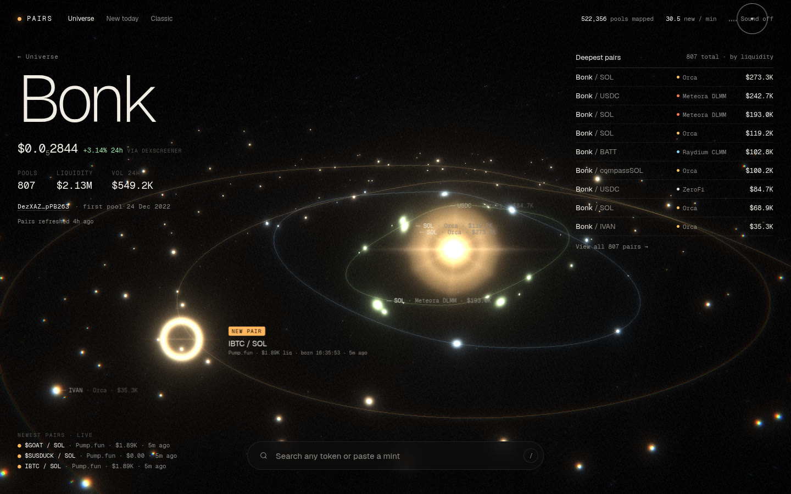

<h1 align="center">Pairverse</h1>

<p align="center">
  <strong>Every pair on Solana, one sky.</strong><br>
  <a href="https://pairverse.fun"><strong>→ pairverse.fun</strong></a>
</p>

<p align="center">
  <a href="https://pairverse.fun"></a>
</p>

---

Pairverse is a Solana pairing database with a face. It keeps track of every token it has seen, every pool that token trades in (SOL, USDC and token-to-token pairs, across Raydium, Orca, Meteora, pump.fun and the rest), and adds new pools as they're created, around the clock.

The front end, **Liquidity Universe**, draws the whole market as one galaxy in WebGL. Every point is a real pool: brighter and bigger means more liquidity, and colour shows what it's paired against. Search a token and the camera flies to it, with its pairs in orbit around it. New pools flare up as they arrive from the live feed.

Right now the database holds about **520,000 pools** and **500,000 tokens**, and adds about 30 new pools a minute.

## What it does

- **Pairing database.** SQLite (WAL) with tokens, pools, the link between them, and liquidity/volume snapshots per pool.
- **24/7 poller.** Reads GeckoTerminal's new-pool feed (plus Jupiter's recent tokens) every couple of minutes, dedupes and stores everything.
- **On-demand enrichment.** The first time someone looks up a token (or when its data is older than 6 hours), Pairverse pulls all of its pools from DexScreener, GeckoTerminal and Raydium in the background.
- **Liquidity Universe.** Three.js galaxy of up to 200k pools, search with ticker-collision warnings, a token view with live price and every pair sortable by liquidity, volume or age, a live new-pool feed, and an optional ambient soundscape made entirely in WebAudio.
- **Public API.** A read-only JSON API plus a Server-Sent Events stream of new pools.

## Public API

Base URL: `https://pairverse.fun`. GET only, about 240 requests per minute per IP.

| Endpoint | What you get |
| --- | --- |
| `GET /api/v1/stats` | Totals: pools, tokens, new pools in the last hour, last poll time |
| `GET /api/v1/search?q=bonk` | Tokens by ticker, name or mint, ranked by liquidity, with pair counts and collision flags |
| `GET /api/v1/token/{mint}?sort=liq\|vol\|age\|oldest&limit=500` | A token, its total pair count, and its pairs (pool, DEX, counter-token, liquidity, 24h volume, created) plus live price |
| `GET /api/v1/new?after=<cursor>&limit=30` | Newest pools (last 3 hours) |
| `GET /api/v1/live` | **SSE** stream: `hello` with a cursor, then `pools` events as new pools are stored |
| `GET /api/v1/galaxy.bin?n=200000` | Float32 buffer used by the galaxy (6 floats per pool) |
| `GET /health` | Liveness |

```bash
curl -s "https://pairverse.fun/api/v1/search?q=bonk" | jq '.results[0]'
curl -N https://pairverse.fun/api/v1/live
```

The older `/api/stats`, `/api/search`, `/api/token/{mint}` and `/api/new` endpoints still work, and a plain lookup page is at `/classic`.

## Quickstart (local)

Python 3.11+.

```bash
git clone https://github.com/LeonidasOfficial/pairverse.git
cd pairverse
python3 -m venv .venv && .venv/bin/pip install -r requirements.txt

# optional, slow: seed every current Raydium + Orca pool
.venv/bin/python seed.py

./start.sh            # poller + API with auto-restart → http://127.0.0.1:8765/
./stop.sh
```

The database is created on first run (`pairs.db` next to the code, or wherever `PAIRS_DB` points). Without the seed, the galaxy starts small and fills in as the poller finds new pools.

A few more tools:

```bash
.venv/bin/python cli.py BONK          # pairs for a token in the terminal
.venv/bin/python cli.py --new-today
.venv/bin/python enrich.py <mint>     # pull every pool for one token now
```

## Self-hosting

`deploy/` has everything to run your own copy on a small VPS with automatic HTTPS: systemd units + Caddy (`install-host.sh`) or Docker Compose (`install-docker.sh`), plus scripts to snapshot and restore a live database. See **[deploy/README.md](deploy/README.md)**.

## Data sources

All free, public endpoints; no keys needed:

- **GeckoTerminal**: new pools feed (pages 1–10) and per-token pools
- **DexScreener**: per-token pairs and live prices
- **Raydium** (api-v3): full pool list and pools by mint
- **Orca**: whirlpool list
- **Jupiter**: recently created tokens (metadata)

The free APIs only expose the most recent pools, so history is built up by polling continuously, plus the Raydium/Orca seed and on-demand enrichment. Liquidity and volume are the latest stored snapshot per pool.

## Go deeper with Helius

The free sources are enough for a pairing map, but they stop there. If you want more, such as full token history, holder data, real-time on-chain transactions and webhooks, or a fast dedicated RPC, connect your own **[Helius](https://www.helius.dev)** API key. Helius has a free tier, and paid plans if you need more volume.

Pairverse supports it out of the box:

```bash
export HELIUS_API_KEY=your-key     # or put it in .env / your systemd unit
./start.sh
```

With a key set:

- token enrichment also calls Helius **DAS `getAsset`** for authoritative metadata (symbol, name, decimals, supply, token program, image), and
- `helius.rpc_url()` gives the rest of the code a Helius mainnet RPC endpoint to build on (holders, transaction history, webhooks).

Without a key, nothing changes and none of it runs. The key is only sent to Helius and never logged. Quick check: `.venv/bin/python helius.py <mint>`.

## Configuration

See [`.env.example`](.env.example). Everything is optional:

| Variable | Purpose |
| --- | --- |
| `PAIRS_DB` | SQLite database path (default `./pairs.db`) |
| `PAIRS_CACHE` | Cache dir for the galaxy buffer and search index (default `./cache`) |
| `HELIUS_API_KEY` | Enables the Helius integration above |
| `PAIRS_TUNNEL` | `1` starts an optional Cloudflare quick tunnel with `./start.sh` |
| `CADDY_EMAIL`, `PAIRVERSE_DOMAIN` | Used by the self-host installers |

## Project layout

```
api.py           FastAPI app: site, /api/v1 router, classic UI, legacy /api
public.py        hardened public API, galaxy/search cache builder, SSE hub
poller.py        24/7 new-pool ingest (GeckoTerminal + Jupiter)
enrich.py        on-demand per-token enrichment (DexScreener, GeckoTerminal, Raydium, Helius)
helius.py        optional Helius DAS / RPC helpers
seed.py          one-shot Raydium + Orca seed
db.py            schema and upserts (SQLite WAL)
http_util.py     HTTP session, retries, shared GeckoTerminal rate limiter
cli.py           terminal lookups
site/            Liquidity Universe front end (Three.js, WebAudio soundscape)
deploy/          VPS / Docker deployment bundle
tools/           offline render of the soundscape
```

## License

[MIT](LICENSE)
